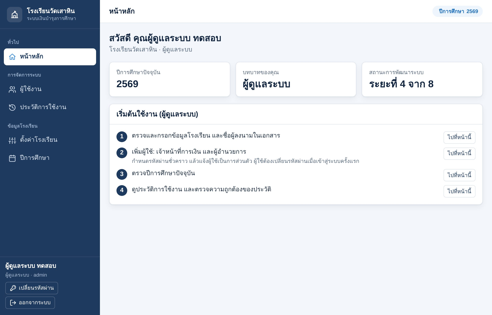
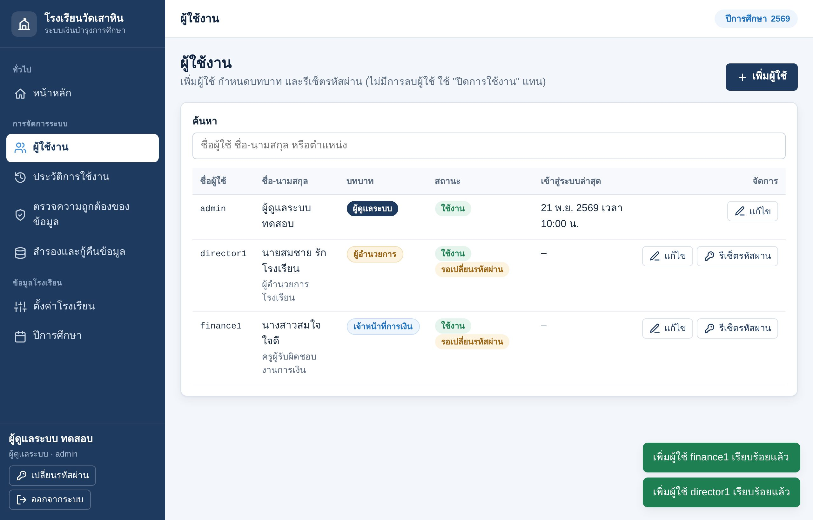
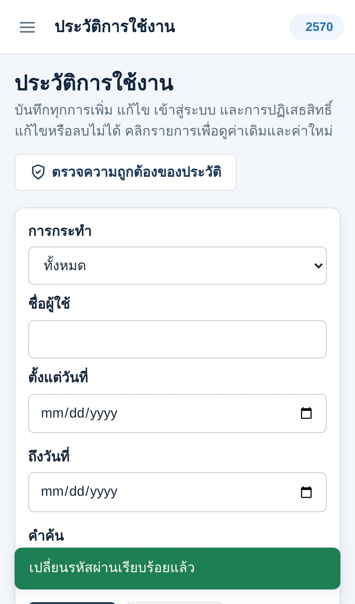

# ระบบบริหารจัดเก็บเงินบำรุงการศึกษา
### โรงเรียนวัดเสาหิน จังหวัดเชียงใหม่

เว็บแอปสำหรับบันทึกและติดตามเงินบำรุงการศึกษาของนักเรียน และใช้เป็นทะเบียนคุมใบเสร็จรับเงินจากเล่มจริงของทางราชการ

- Backend: Google Apps Script
- ฐานข้อมูล: Google Sheets
- Frontend: HTML, CSS, JavaScript

> ระบบนี้**ไม่ออกใบเสร็จอิเล็กทรอนิกส์** ทำหน้าที่เป็นทะเบียนคุมและบันทึกอ้างอิงใบเสร็จจากเล่มจริงเท่านั้น

## ติดตั้ง (วางไฟล์เดียว)

1. ใน Google Sheets เปิด **ส่วนขยาย → Apps Script**
2. คัดลอกเนื้อหาไฟล์ [`dist/Code.gs`](dist/Code.gs) ทั้งไฟล์ ไปวางทับโค้ดเดิมใน `Code.gs` แล้วกดบันทึก
3. เลือกฟังก์ชัน `SetupDatabase` แล้วกด **เรียกใช้ (Run)** และอนุญาตสิทธิ์
4. ครั้งแรก: รีเฟรช Google Sheets → เมนู **ระบบเงินบำรุงการศึกษา → 3) สร้างหรือรีเซ็ตบัญชีผู้ดูแลระบบ**
5. ครั้งแรก: **Deploy → New deployment → Web app** (Execute as: Me / Who has access: Anyone with Google account)

ขั้นตอนละเอียด การอัปเดต และวิธีทดสอบอยู่ใน [docs/INSTALL.md](docs/INSTALL.md)

## หน้าตาระบบ

| คอมพิวเตอร์ | มือถือ |
|---|---|
|  |  |
|  |  |

## ความคืบหน้า (8 ระยะ)

| ระยะ | งาน | สถานะ |
|---|---|---|
| 1 | โครงสร้างระบบและฐานข้อมูล (`SetupDatabase()`, ชั้นข้อมูล, ประวัติการใช้งานแบบลูกโซ่ hash) | ✅ เสร็จ |
| 2 | ระบบ Login และสิทธิ์ (ผู้ใช้ ตั้งค่าโรงเรียน ปีการศึกษา ประวัติการใช้งาน หน้าเว็บ) | ✅ เสร็จ |
| 3 | ระบบนักเรียน | ⏳ ถัดไป |
| 4 | ระบบเรียกเก็บและรับชำระ (รวมส่วนแกนของทะเบียนเล่มใบเสร็จ) | |
| 5 | ระบบทะเบียนคุมใบเสร็จเต็มรูปแบบ | |
| 6 | ระบบยอดค้าง | |
| 7 | Dashboard รายงาน และสำรอง/กู้คืนข้อมูล | |
| 8 | ทดสอบทั้งระบบ คู่มือ และ checklist ก่อนใช้งานจริง | |

## เอกสาร

| เอกสาร | เนื้อหา |
|---|---|
| [docs/INSTALL.md](docs/INSTALL.md) | วิธีติดตั้งและทดสอบทีละขั้นตอน |
| [docs/DECISIONS.md](docs/DECISIONS.md) | การตัดสินใจแทนเจ้าหน้าที่การเงิน 22 ข้อ และแบบตรวจยืนยันก่อนใช้งานจริง |
| [docs/ARCHITECTURE.md](docs/ARCHITECTURE.md) | สถาปัตยกรรม โครงสร้างข้อมูล ความปลอดภัย และแผนการพัฒนา |

## สำหรับผู้พัฒนา

```
src/      ซอร์สโค้ดแยกไฟล์ (แก้ที่นี่)
dist/     ไฟล์รวม Code.gs สำหรับติดตั้ง (สร้างด้วย npm run build ห้ามแก้โดยตรง)
tests/    ชุดทดสอบอัตโนมัติ รันบน Node.js กับ Google Sheets จำลอง
docs/     เอกสาร
```

ต้องมี Node.js 20 ขึ้นไป ไม่ต้องติดตั้งแพ็กเกจเพิ่ม

```bash
npm run build
```

```bash
npm test
```

```bash
npm run test:e2e
```
